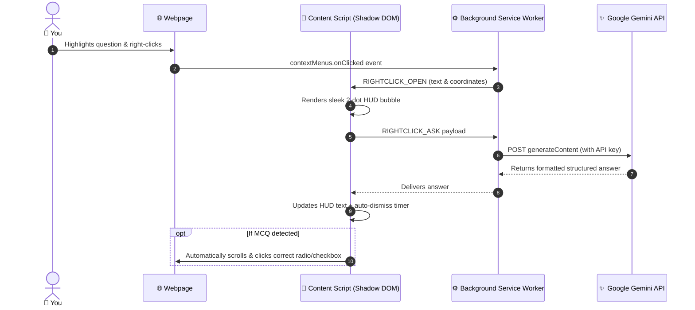

RightClik

## ⚡ Highlights & Key Capabilities

```
  [ Highlight Any Text ] ──► [ Right-Click ] ──► [ Instant Floating HUD ] ──► [ Auto-Selects Option ]
```

- 🎯 **One-Click Answer Floating HUD**: Clean, unobtrusive Shadow DOM bubble that floats directly above your cursor. No disruptive page navigation or tab switching.
- ⚡ **Automated MCQ Solver & Form Filler**: Detects questions with multiple choices (A, B, C, D) and automatically clicks the correct radio button, checkbox, or label on the webpage.
- 👁️ **Vision Scan (Image Context Menu & Upload)**: Right-click any image diagram, graph, or math equation directly on the web, or upload screenshots via popup.
- 🛡️ **Zero API Key Leakage / 100% Client-Side**: Your Gemini API key is stored strictly within your browser's `chrome.storage.local`. There is no middleman backend or external telemetry server.
- 🎛️ **Configurable Gemini Models**: Default to ultra-fast `gemini-2.5-flash-lite`, or switch dynamically to `gemini-2.5-flash`, `gemini-1.5-pro`, or any custom model available on Google AI Studio.

---

## 🕹️ Interactive Feature Matrix

| Mode | Trigger | Best For | Output Format |
| :--- | :--- | :--- | :--- |
| **Quick Answer** | `Right-click text` → *Get Answer* | Quizzes, facts, definitions | Ultra-concise direct answer |
| **Auto-MCQ** | `Right-click MCQ question` | Multiple-choice exams & tests | Identifies & clicks the correct option |
| **Vision Scan** | `Right-click image` → *Get Answer (Image)* | Diagrams, formulas, charts | Multimodal image breakdown |
| **Explain** | Extension Popup → *Explain* | Learning difficult concepts | Step-by-step simple explanation |
| **Hint** | Extension Popup → *Hint* | Self-study & guided practice | Clue without spoiling answer |
| **Pointers** | Extension Popup → *Pointers* | Quick revision | Bulleted key points |
| **Essay** | Extension Popup → *Essay* | Long-form questions | Structured academic draft |

---

## 🔄 How It Works Under The Hood



---

## 🚀 Quick Setup Guide

<details open>
<summary><b>Step 1: Install the Extension in Chrome / Chromium</b></summary>
<br>

1. Download or clone this repository:
   ```bash
   git clone https://github.com/Greeshma-Girish/9RightClick.git
   ```
2. Open Google Chrome (or Brave / Edge / Arc / Chromium).
3. Navigate to `chrome://extensions/` in your address bar.
4. Toggle the **Developer mode** switch in the top-right corner.
5. Click **Load unpacked** in the top-left corner.
6. Select the folder containing `manifest.json`.

</details>

<details open>
<summary><b>Step 2: Add Your Gemini API Key</b></summary>
<br>

1. Generate a free API key at [Google AI Studio](https://aistudio.google.com/apikey).
2. Click the **RightClick AI** extension icon from your Chrome toolbar.
3. Click **Settings** in the popup footer (or right-click extension icon → *Options*).
4. Paste your API key into the **Gemini API key** field.
5. *(Optional)* Customize the model (default: `gemini-2.5-flash-lite`).
6. Click **Test connection** to verify connectivity, then click **Save settings**.

</details>

---

## 🔒 Security & Privacy Architecture

<details>
<summary><b>Is my API key safe? (Click to view security audit)</b></summary>
<br>

- ✅ **No Hardcoded Keys**: The source code and Git repository contain zero API keys or secrets.
- ✅ **Local Sandbox Storage**: Keys are saved exclusively via Chrome's native [`chrome.storage.local`](https://developer.chrome.com/docs/extensions/reference/api/storage#property-local) sandbox on your computer.
- ✅ **Direct Endpoint Dispatch**: Requests are sent directly from your browser's service worker to `https://generativelanguage.googleapis.com` via HTTPS with standard `x-goog-api-key` headers.
- ✅ **Protected by `.gitignore`**: Sensitive patterns (`.env`, `credentials.json`, `*.zip`, `.vscode/`) are strictly ignored so you cannot accidentally push private credentials.
- 💡 **Best Practice**: Never paste your API key into code files or share packaged `.crx` builds that have pre-filled credentials.

</details>

---

## ⌨️ Pro Tips & Shortcuts

- **Pause Auto-Dismiss**: Hover your mouse over the floating answer bubble to pause the timer while you read!
- **Quick Dismiss**: Click anywhere outside the bubble, or press `Escape` to instantly dismiss it.
- **Copy Formatted Code**: Code snippets inside answers are formatted with clean inline styling for easy readability.
- **Model Flexibility**: For complex code generation or heavy reasoning, switch the model to `gemini-2.5-flash` or `gemini-1.5-pro` in Settings anytime.

---

## 🛠️ File Structure

```
9RightClick/
├── manifest.json       # Chrome Manifest V3 configuration & permissions
├── background.js       # Context menu lifecycle & Gemini API network broker
├── content.js          # Injected Shadow DOM floating bubble & MCQ auto-clicker
├── popup.html          # Browser toolbar action interface
├── popup.js            # Toolbar logic & vision file uploader
├── popup.css           # Modern dark-theme popup styles
├── options.html        # Settings page (API key & model selection)
├── options.js          # Options storage handler & connection test
├── options.css         # Options styling
├── assets/             # SVGs, banners, and preview mockups
│   ├── banner.svg
│   └── ui-preview.svg
├── .gitignore          # Repository protection against secret leaks
└── README.md           # Documentation
```

---

<p align="center">
  Crafted with care for faster studying & seamless browsing.
</p>
