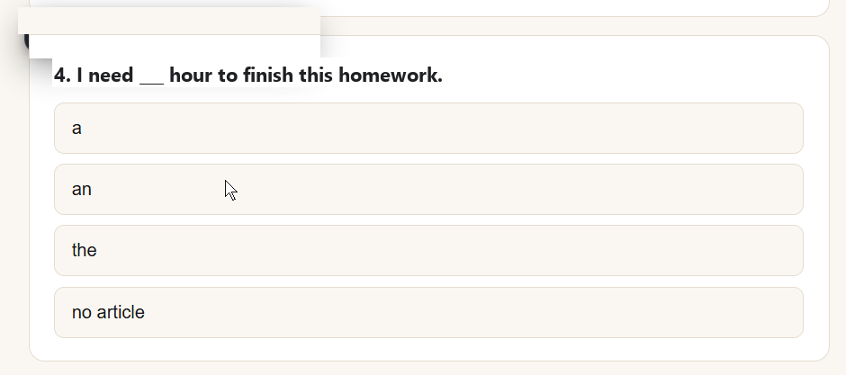
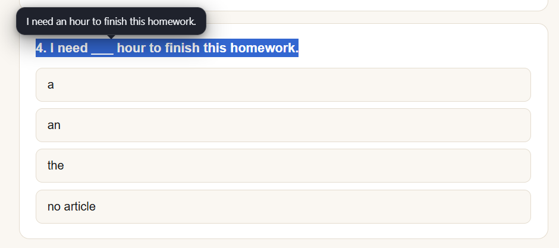

# RightClick AI

Get answers without leaving the page you're browsing.

RightClick AI is a Chrome extension that lets you select text or right-click an image to get an instant AI-generated response. The answer appears in a small floating bubble near your cursor.

No copying. No pasting. No switching tabs. No sidebar.

## Features

- **Get Answer:** Select any text on a webpage, right-click, and choose *Get Answer*. The answer appears immediately in a floating bubble.
- **Get Answer from Image:** Right-click an image and choose *Get Answer from Image* to get an AI-generated response based on its content.
- **Floating Answer Bubble:** Responses appear just above your mouse pointer, keeping the interaction close to where you're browsing.
- **No Sidebar:** No separate chat window, dashboard, or popup interface.
- **Auto-Dismiss:** The answer bubble disappears automatically after a few seconds.

## How It Works

1. Select any text on a webpage.
2. Right-click and select **Get Answer**.
3. Your answer appears in a floating bubble near your cursor.

For images, simply right-click an image and select **Get Answer from Image**.

## Demo

---

<p align="center">
  
</p>

<p align="center">
  <em>Drag to select text ➔ Right-click ➔ Choose <b>Get Answer</b> ➔ Instant floating HUD bubble.</em>
</p>

<details>
<summary><b>📹 View / Embed High-Definition MP4 Video</b></summary>
<br>

```html
<video width="100%" controls autoplay loop muted playsinline>
  <source src="assets/demo.mp4" type="video/mp4">
  Your browser does not support the video tag.
</video>
```
*(The raw video is saved at `assets/demo.mp4` in this repository).*
</details>

---

## 📸 Real Screenshot (In-Action)

No mockups, no AI slop — here is RightClick AI running live on an actual quiz question:

<p align="center">
  
</p>

*The dark floating bubble appears directly above the highlighted question with the answer ready immediately.*

---

## Installation

1. Clone this repository:

   ```bash
   git clone https://github.com/YOUR-USERNAME/YOUR-REPOSITORY.git
   ```

2. Open Chrome and navigate to:

   ```text
   chrome://extensions/
   ```

3. Enable **Developer mode**.
4. Click **Load unpacked**.
5. Select the cloned project folder.
6. The extension is ready to use.

## Usage

| Action | Result |
|---|---|
| Select text → Right-click → Get Answer | Get an answer about the selected text |
| Right-click an image → Get Answer from Image | Get an answer based on the image |

## Why RightClick AI?

Most AI tools require you to open another tab, copy content, paste it into a chat window, and wait for a response.

RightClick AI removes those extra steps. Select something, right-click, and get your answer where you need it.

---

<<<<<<< HEAD
**RightClick AI** — Right-click. Get answers. Keep browsing.
=======
**RightClick AI** — Right-click. Get answers. Keep browsing.
>>>>>>> bc14c951d4eb0bfbad08e48bb69870521ff5f3a8
